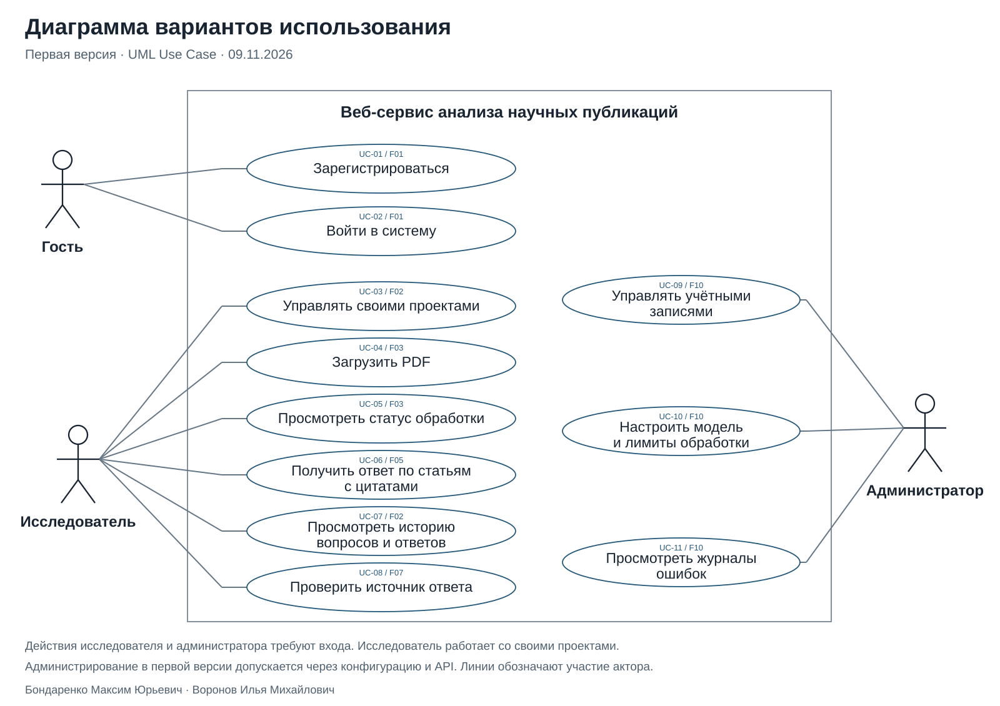

# Разработка веб-сервиса анализа научных публикаций

Учебный проект: **Бондаренко Максим Юрьевич** и **Воронов Илья Михайлович**.

Сервис поможет задавать вопросы по научным статьям и проверять ответы по исходным текстам.

## Первая версия

**Загрузить PDF → задать вопрос → получить ответ → открыть страницу и фрагмент источника.**

Поиск новых публикаций, сравнение статей и многошаговый агент запланированы после первой рабочей версии.

## Диаграмма вариантов использования

[PNG](docs/diagrams/use-cases.png) · [PDF](docs/diagrams/use-cases.pdf) · [Редактируемый draw.io](docs/diagrams/use-cases.drawio)

## Статус

Подготовлены требования и исследовательские материалы. Реализация приложения и испытания — следующие этапы.

## Материалы проекта

| Файл | Содержание |
|---|---|
| [PLAN.md](PLAN.md) | План до конца семестра |
| [BACKLOG.md](BACKLOG.md) | Задачи и критерии готовности |
| [Аналоги и критерии](docs/analysis.md) | Введение, функции и интерфейсы аналогов, паспорт критериев |
| [Описание ПО](docs/design.md) | Функции, роли, диаграмма вариантов использования и технологический стек |
| [Статьи и литература](docs/articles.md) | Паспорта научных статей и источники |

Рабочая [доска GitHub Projects](https://github.com/users/Garxxss/projects/1/views/1) может требовать отдельного доступа. Для преподавателя план и задачи доступны по ссылкам выше.
