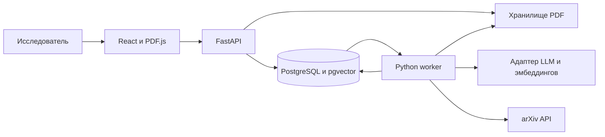

# Архитектура сервиса

Проектируемая архитектура; компоненты ниже ещё предстоит реализовать.

## Поток обработки

1. React-клиент отправляет PDF или поисковый запрос в FastAPI. API проверяет вход, сохраняет документ и создаёт запись jobs; длительная работа не привязана к HTTP-запросу.
2. Worker получает задание, извлекает текст через pypdf постранично, сохраняет фрагменты и их происхождение, получает эмбеддинги через адаптер и записывает их в PostgreSQL/pgvector.
3. Для вопроса worker ищет подходящие фрагменты и передаёт их генеративной модели. Машина состояний ограничивает число шагов и сохраняет результаты инструментов и переходы.
4. Перед сохранением ответа приложение проверяет идентификаторы цитат и номера страниц. Ответ, доказательства и статус задания доступны клиенту; о недостаточности материалов сообщается явно.
5. Клиент показывает ответ и открывает исходный PDF в PDF.js на указанной странице. При включённом внешнем поиске arXiv добавляет метаданные и доступный документ в тот же конвейер.

## Границы ответственности

- API проверяет авторизацию и принадлежность проекта при каждом доступе к документам и результатам.
- Worker сохраняет шаги и состояние длительных заданий; ошибка или перезапуск не должны терять историю.
- Проверка идентификатора цитаты и страницы не равнозначна смысловой проверке утверждения.
- Текстовый слой PDF обязателен для первой версии; OCR и надёжный разбор формул и таблиц требуют отдельного этапа.

## Риски

- Извлечение текста из научных PDF. Колонки, формулы, таблицы и сканы могут дать неполный или неверно упорядоченный текст, что ухудшает поиск и подтверждение ответа. Меры: Ограничить первый корпус PDF с текстовым слоем, хранить номера страниц и исходные файлы, проверять извлечение на контрольных публикациях; неподдержанные файлы отклонять с объяснением. OCR и специализированный парсер добавлять после измерения потребности.
- Качество, ресурсы и маршрут данных при работе с LLM. Модель может дать неподтверждённый ответ; локальный запуск может не уложиться в доступную память, а удалённые вызовы передают контекст выбранному сервису. Меры: Провести пилот на фиксированном корпусе, измерить память, время и подтверждённость цитат; зафиксировать модель, ревизию и параметры. Проверить адреса генерации и эмбеддингов, правила работы с документами и отказ при недостатке доказательств.
- Повторное выполнение задания после сбоя. Worker может остановиться между внешним запросом и записью результата; повтор вызовет дублирование операции или дополнительный расход на LLM. Меры: Сохранять состояние шагов, использовать lease и идемпотентные записи с уникальными ключами, ограничить попытки и бюджет; проверить сценарии остановки и восстановления. Гарантия exactly-once для внешнего LLM API не предполагается.
