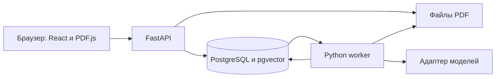

# Функции, роли и технологический стек

Это описание планируемого ПО. Приложение пока не реализовано.

## Границы первой версии

Исследователь входит в сервис, создаёт проект, загружает PDF с текстовым слоем, задаёт вопрос по выбранным документам и проверяет ответ по странице и исходному фрагменту. Сервис показывает состояние обработки, ошибки и отсутствие достаточных сведений.

## Роли

| Роль | Возможности |
|---|---|
| Исследователь | Свои проекты, PDF, вопросы, история ответов и просмотр источников |
| Администратор | Учётные записи, конфигурация модели, лимиты обработки и журналы ошибок |

Гостю доступны регистрация и вход. Административная роль сама по себе не даёт доступа ко всем пользовательским документам.

## Функции

| Код | Функция и ожидаемое поведение | Этап |
|---|---|---|
| F01 | Регистрация, вход и проверка доступа к собственным проектам | Первая версия |
| F02 | Создание проекта и хранение его публикаций и истории вопросов | Первая версия |
| F03 | Загрузка PDF, извлечение текста по страницам; статусы обработки и ошибки | Первая версия |
| F05 | Вопросы по выбранным документам; ответ с цитатами либо сообщение о нехватке сведений | Первая версия |
| F07 | Переход от цитаты к исходному PDF, странице и подтверждающему фрагменту | Первая версия |
| F10 | Конфигурация провайдера модели и лимитов; управление учётными записями | Первая версия; сначала без отдельной панели администратора |
| F04 | Поиск через один научный API и импорт метаданных с защитой от дубликатов | Дальнейшее развитие |
| F06 | Сравнение статей по готовым и пользовательским полям; источник для каждого значения | Дальнейшее развитие |
| F09 | Экспорт сравнительной таблицы в CSV | Дальнейшее развитие |
| F08 | Многошаговый агент с пределом шагов, журналом и остановкой | Дальнейшее развитие |

## Основной сценарий

1. Создать проект и загрузить PDF. Для повреждённого файла, скана без текстового слоя или превышения лимита показать причину отказа.
2. Дождаться завершения обработки и выбрать документы для вопроса.
3. Получить ответ с цитатами. При нехватке доказательств показать сообщение об этом.
4. Открыть цитату: увидеть фрагмент и перейти на нужную страницу PDF.

В первой версии не планируются OCR, автоматический разбор сложных формул и таблиц, произвольное выполнение кода и отдельный агентный фреймворк.

## Технологический стек

Предлагаемый набор для одной небольшой системы. Версии и конфигурации закрепляются при реализации.

| Часть | Технологии | Зачем |
|---|---|---|
| Интерфейс | React, TypeScript, Vite; PDF.js | Загрузка, вопрос, ответ и просмотр страниц источника |
| Сервер | Python, FastAPI, Pydantic | API, проверка входных данных и прав доступа |
| Данные | PostgreSQL, pgvector; SQLAlchemy, Alembic | Проекты, фрагменты и векторный поиск в одной базе |
| PDF | pypdf | Извлечение текста с сохранением номера страницы |
| Обработка | Один Python worker и таблица jobs в PostgreSQL | Статусы длительных заданий и сохранение результатов |
| Модели | Один адаптер к Ollama или совместимому HTTP API | Эмбеддинги и генерация ответа; смена провайдера через конфигурацию |
| Запуск и проверка | Docker Compose, pytest, Playwright, GitHub Actions | Воспроизводимый запуск и проверка основного сценария |

Стартовые кандидаты для пилота — [Qwen3-8B](https://huggingface.co/Qwen/Qwen3-8B) и dense-эмбеддинги [BGE-M3](https://huggingface.co/BAAI/bge-m3) размерности 1024. Окончательный выбор зависит от памяти, времени и качества на доступном оборудовании. При смене модели эмбеддингов документы индексируются заново.

Для следующих этапов достаточно добавить arXiv API и ограниченную машину состояний на Python. Отдельные брокер очередей, векторная СУБД и агентный фреймворк пока не требуются.

## Схема обработки

API проверяет доступ и сохраняет задание. Worker извлекает страницы и фрагменты, строит поисковые векторы, находит контекст вопроса и получает ответ модели. Ответ хранится вместе с идентификаторами фрагментов и страниц; браузер открывает источник по цитате.

Основные сущности: пользователь, проект, документ, страница/фрагмент, задание, вопрос, ответ и цитата. Каждый результат связан с проектом. Worker сохраняет статус и ограничивает повторы; повторное выполнение должно быть идемпотентным. Вызов внешней модели не должен удерживать блокировку базы.

## Ограничения и проверка

- Проверка номера страницы и идентификатора цитаты не доказывает смысловую верность ответа: её оценивают по контрольным вопросам и фрагментам.
- Сложная вёрстка PDF может нарушать порядок текста. Для первой версии отбирается корпус с проверенным текстовым слоем.
- Локальная модель требует проверки оборудования и фактического маршрута данных; удалённый API получает переданный контекст.
- После сбоя worker возможен повтор внешнего запроса. Сохраняются состояния и результаты шагов; проверяется восстановление, гарантия exactly-once не заявляется.

Методика оценки — в [аналогах и критериях](analysis.md#измеримые-показатели), официальная документация — в [списке источников](articles.md#техническая-документация).
